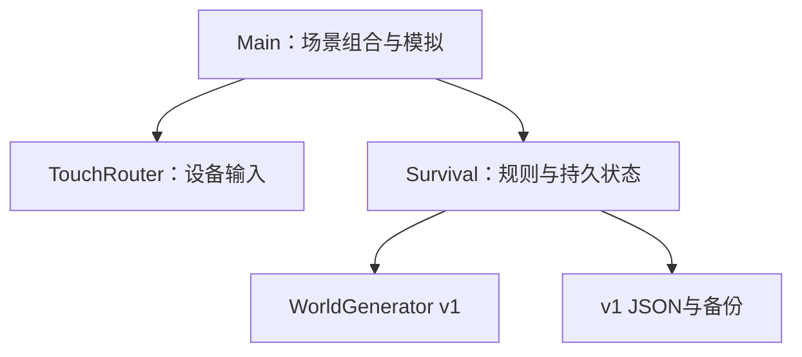

# 当前架构与演进边界

以当前代码为准；本文件明确区分已存在模块与待拆分模块。产品决定见[DECISIONS.md](DECISIONS.md)，实施队列见[ROADMAP.md](ROADMAP.md)。

## 已存在的结构

| 文件 | 实际责任 | 约束 |
|---|---|---|
| `scenes/main.tscn` | 主场景入口 | 保留当前启动路径 |
| `scripts/main.gd` | 组合、世界加载、碰撞、战斗/尸潮更新、建造占用检查、UI和绘制 | 仍是主要技术债，不在此继续堆大批新子系统 |
| `scripts/touch_router.gd` | 按钮注册/注销、每指捕获、按住、取消、模态筛选 | 不读写营地或库存；通过既有按钮信号交给业务 |
| `scripts/survival.gd` | 物品/蓝图、材料交易、营地、运单、角色、保存恢复 | `stash`与局部计时为当前营地的运行别名，切换必须经过封装方法 |
| `scripts/world_generator.gd` | 固定种子/坐标的v1静态地形、容器、游荡者生成 | 无场景、库存或文件IO；不改变旧v1随机序列 |
| `scripts/check_project.py` | 引擎导入与统一隔离检查 | 当前只支持Linux；与CI相同 |
| `scripts/fetch_font.py` | 固定提交的字体与OFL下载 | 字体文件下载后导入，二进制不入Git |

## 输入边界

手机`InputEventScreenTouch`先进入TouchRouter。路由器倒序检查可见按钮，限制当前模态面板，按手指index捕获按钮；结束时发出button_up与合格的pressed。动态按钮退出树时立即注销，同一按钮多指触摸在最后一根释放后结束按住。

未被UI处理的触摸继续进入Main的`_unhandled_input`，管理移动摇杆和世界建造。桌面鼠标仍由Godot普通按钮和场景处理。关闭触摸转鼠标模拟是有意的，不能在不知道重复动作影响时随意开启。

## 世界、单位与兼容

- 世界坐标单位当前相当于2D像素/逻辑单位，不代表真实米。
- 建造格64，世界分块768，主场景保持附近3×3活动分块。
- 结构使用绝对格坐标字符串；营地用`camp_cell`确定核心。出生点、领地、撤离与攻营相对此核心计算。
- 静态世界v1使用固定引擎4.4.1、种子与坐标哈希、固定随机调用次序和冻结物品表顺序。
- 容器ID由块坐标/本地编号组成；游荡者ID再带日期。已领取数量与已杀敌记录是相对于静态生成的修改。
- `tests/fixtures/world_v1.json`在拆分前采集，包含原点、正坐标、负坐标与远坐标样本；升级生成算法先设计版本选择与迁移。

当前“持续生成”不是无限内存、无限文件或无限浮点精度。区域持久化与远距离局部坐标转换还未完成。

## 营地与后勤所有权

`camps[id]`包括名字、绝对格坐标、stock、threat、generator_seconds、turret_rounds。建筑有`camp_id`。当前营地别名`stash/threat/generator_seconds/turret_rounds`经`_store_active_camp()`保存，经`_activate_camp()`装载；外部通过`enter_camp()`与`found_outpost()`访问，不直接调用内部激活方法。

营地科技、领地、维修和炮台供能只作用于当地。新前哨有空仓库和独立计时，不能复制开局物资或把炮台余弹带到另一个营地。

运单包含source、target、cargo、seconds、risk、ambush。派遣时扣货物和运费；遇袭结果在派遣时固定，重启不重抽；到货加目标stock并移除运单。当前只有调拨，没有市场/货币/NPC交易和实体运输路线。

## 时间与远近模拟

- Main用每帧delta、上限0.05更新当前现场模拟。低帧率会减慢模拟，这是已知问题。
- 营地、背包和暂停菜单暂停玩法；自动保存仍可运行，部分画面时间仍推进。
- 攻营离线不推进。远方营地生产和战斗目前冻结；运单仅随在线玩法模拟时间递减。
- 下一阶段应由SimulationClock显式管理固定tick、追帧上限与暂停域，再添加区域摘要。不能让现场和远方对同一批产出重复结算。

## 保存与兼容

文件仍为`user://camp_v1.json`，SAVE_VERSION=1。写`.tmp`、尝试复制`.bak`、重命名替换；读取失败时尝试备份。当前不足是完整类型/范围/关联校验以及恢复原子性，列为下一项P0。

本轮营地局部计时兼容读取旧全局字段：只把旧值迁移给保存时的活跃营地；旧的非活跃营地缺少计时字段时从0开始。新增camp字段不需要清空旧v1存档。

尸潮重载重建尚未击杀的攻营单位，位置和受伤值不保存；游荡者同样不保存当前动态位置/受伤值。后续改变需说明玩家可见差异，不能宣称已有完整动态世界快照。

## 下一阶段的目标模块（尚未全部存在）

| 模块 | 应拥有的状态/行为 | 对外接口方向 |
|---|---|---|
| SaveRepository + SaveValidator | 文件IO、候选数据校验、迁移、事务提交、备份策略 | load_candidate / validate / commit / save |
| WorldStreamer + WorldOccupancy | 活动块、实体驻留、空间查询、建造占用、区域修改记录 | query / reserve / release / load_region |
| ConstructionController | 选格、蓝图预览、施工请求 | 校验通过后只提交一次材料交易与占用变化 |
| CombatSystem | 射击、弹药、伤害、生命、战斗事件 | 输入命令进入，事件供HUD与声画消费 |
| SiegeDirector | 预警、组合、进攻方向、波次与结果 | 依赖世界查询和战斗，不直接改UI |
| CampNetwork + Logistics | 地方库存、产能、运力、运单、调拨/未来贸易 | 明确所有权、在途账本、只结算一次 |
| HUD + WorldRenderer | 展示和反馈、素材、遮挡与动画 | 读取状态快照和事件，不悄悄修改资源 |

依次拆分并保留行为检查，不一次改写所有脚本。存档安全、施工占用和寻路是扩展经营策略的前置条件。

## 移动端与美术边界

当前Compatibility渲染、有限活动分块、有上限的尸潮；没有真实设备帧率数据。画面包括首轮生成地表/树木及程序绘图，仍缺角色/建筑/动画/声音统一。先用实际设备数据确定空间索引、AI tick和画面档位，再考虑对象池或更复杂渲染。

不申请联网权限，不上传存档/遥测。工程当前无GLoot、Voxel Tools等native模块；这些只是曾调研的候选，不是实际依赖。官方Godot为MIT，Noto字体为OFL，生成美术说明与提示词见`ART_DIRECTION.md`。
